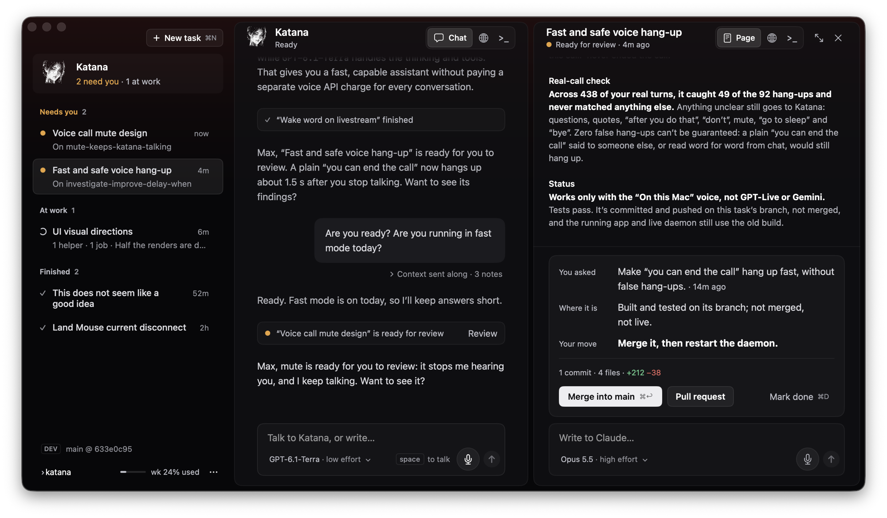

# Katana shell

A SwiftUI front end for Katana with nothing behind it: the sidebar, Katana's pane, the task page beside it, a task page in its own window, and the New task sheet. It only draws and reports what the user did. Wire it to Katana's real state and daemon.

Colors, type and spacing are read off screenshots and a stream of the current build, so they are close, not exact. They all live in `KatanaTheme.swift`.



## Run it

From this folder (the one with `Package.swift`):

```bash
swift run KatanaShellDemo
```

Or open `Package.swift` in Xcode and run the `KatanaShellDemo` scheme. The views also have SwiftUI previews (`Previews.swift`). Needs macOS 14 or later and Swift 6.

The demo has made-up tasks and canned replies so every button does something. About 25 seconds after launch the "Voice call mute design" task becomes ready for review and Katana says so. The **Task** menu can open the beside task in its own window, set its status and reset the demo. The **Katana** menu starts and stops listening and has a **Demo: Speak / Stop Speaking** action to preview the avatar.

The approved first portrait and talking GIF are bundled in `Sources/KatanaShellDemo/Resources`. Both the portrait in Katana's pane header and the sidebar portrait show the PNG while idle and loop the GIF while Katana speaks. Canned replies simulate speech for a few seconds based on their length, then return to the PNG. Listening and thinking do not start the animation. There is no audio or model call.

The sidebar uses a larger portrait without a dark tile. Both assets have transparent backgrounds, made from the originals by turning brightness above their slate background into alpha, so the card shows between the dots. Sidebar size and scale live in `KatanaTheme.swift`.

The colors are a dark palette: the window frame is the darkest (`#070709`) and the sidebar sits directly on it with no pane of its own; Katana's pane and task pages are a step lighter (`#111114`) with hairline borders, drawn at 70% (`paneOpacity`) so the frame and its glow show faintly through; set it to 1 for solid panes. Bubbles are `#1B1B1F`, borders and selected fills translucent white (the selected Katana card in the sidebar uses the darker `sidebarCard`), text `#DADADF` for body (bold runs and titles stay `#FFFFFF`) / `#BCBDC6` / `#95969E`. The frame has a soft red light falling from its top edge across the full width, so it shows behind the sidebar and around the panes: `#E3342F` at 11% at the top, a third as strong 20% down (`glowMidpoint`), gone 38% down. Use `.katanaWindowBackground()` for any window's frame (the demo's task window does too); the values are `windowBackground`, `glow` and `glowHeight` in `KatanaTheme`. The first version of this shell used slate-blue values instead.

The change summary colors its "+212" green and "−38" red. Body text is 15 pt with lines about 22 pt apart (`lineSpacing` 4) and clearly larger gaps between paragraphs, so long agent reports read as paragraphs rather than a wall.

There is one button family: a filled near-white `PrimaryButton` for the one main next step ("Merge into main"), a raised `SecondaryButton` beside it ("Pull request", "Done"), and a bare `GhostButton` for dialog actions ("Cancel"). Header actions are bare icons with tooltips (`HeaderIconButton`): "Go to it" is an expand icon, close an ×. A task's status sits under its title in the page header ("● Ready for review · 4m ago"). Its closing "You asked / Where it is / Your move" rows, its change summary and its buttons sit together in one card (`OutcomeCard`). A task page pins that card above its composer, so the decision stays in view while the story scrolls above it; the transcript gives way first when the window is short. `TaskButton.Style.finish` ("Mark done" in the demo) sits apart at the card's far end as a bare button, so ending the task doesn't read as a delivery action. Report bullets that start with a bold label ("**Status:** …") are set as small labeled sections, with the first sentence of each in bold as its conclusion. A hairline marks the pinned footer. Both panes' view tabs sit in one shared track (`PaneTabs`), and the selected tab shows its name: "Chat" (a speech bubble) in Katana's pane, "Page" on a task page, "Browser", "Terminal". `quiet:` drops the track and names if a pane wants bare icons. Katana's portrait is no longer a large face over the conversation: it sits small in her pane's header beside "Katana" (`headerAvatarSize`), with a state line under the name ("Ready", "Listening", "Speaking", "Thinking…"), so the conversation gets the pane's full height and both pane headers have two lines. The sidebar's Katana card is lower (`sidebarAvatarSize` 44), so the portrait doesn't take two big spots. Scrolled text fades out fully under a pane's header (`topFade`, `topFadeClear`). Model labels show the model in secondary text and effort quieter (`ModelLabel`).

Status reads the same everywhere: a turning arc while working, an amber dot when a task needs you (a question, or a result ready for review), a quiet gray check when finished, a red cross when it failed. The "Needs you" group label and the "needs you" count on the Katana card are amber too, and each group label shows its count. The open task's row has a raised fill and edge. "New task" is a small raised button with its ⌘N hint, and the footer's dev line shows only the build ("main @ 633e0c95"), with the commit subject in its tooltip. `TaskStatus.review` ("Ready for review") is new: the agent is done and its result waits for your call, usually a merge. It counts as needing you, so the Katana card says "1 needs you" and the task sits under "Needs you"; `finished` is for tasks that need nothing more (in the demo, merging moves a task from review to finished). The sidebar groups tasks under "Needs you", "At work" and "Finished", titles on up to two lines, with the time since the status changed on each row; finished rows leave out their second line. The usage meter is a thin bar. A task page's story (the agent's progress and report) is 13.5 pt secondary text, so its outcome card reads first. Pane titles are 16 pt semibold. The composer has two rows: what you write on top; the model and effort, the key hint, the mic and a round send button along the bottom. Pass `setEffort` (in `KatanaPaneActions`, `TaskPageActions`, or `taskEffort` in `WorkspaceActions`) and the model becomes a menu for low, medium or high effort, with a chevron; without it, it is a plain label. The account shows on hover. Both mics sit in the same round pill. In Katana's conversation, her newest line stays bright and older ones step back (`earlierText`). Task events are small rows of their own; give `KatanaMessage.Kind.event` a `taskID` and pass `openTask` in `KatanaPaneActions`, and the row gets a "Review" (or "Open") button for that task. The context Katana sent along with a message ("Beside you: …", what the mic heard) is folded into one quiet line under the bubble ("Context sent along · 3 notes") that opens on click. Katana's key hint reads "space to talk", with "space" drawn as a key, beside the mic. Task pages fade their top edge under the header like Katana's conversation does.

## What's in `Sources/KatanaShell`

This folder is the part to copy into Katana. The demo app in `Sources/KatanaShellDemo` is only there to show it.

| File | What it is |
| --- | --- |
| `KatanaWorkspaceView.swift` | The main window: sidebar, Katana (or the task you went to), and the task page beside it. |
| `SidebarView.swift` | New task, the Katana card, the task list (active tasks first) and the footer with the usage meter and "···" menu. |
| `KatanaPaneView.swift` | The header (Katana's portrait, "Katana", "Listening" while she listens, quiet view icons), the conversation (Katana, your bubbles with the context sent along folded under them, status lines) and the composer. |
| `TaskPageView.swift` | A task page: title with its status, view tabs, transcript, the outcome card pinned above the composer, composer. |
| `TranscriptView.swift` | Inline Markdown text, bullets, label rows, the bubble, and the outcome card ("You asked / Where it is / Your move", change summary and buttons in one card). |
| `Components.swift` | Header view tabs, primary, secondary and ghost buttons, status dot, model label, composer, placeholders for browser and terminal, the red glow on the window frame. |
| `HalftoneAvatar.swift` | `KatanaAvatar`. Takes a still `image:`, optional local GIF `speakingAnimationURL:`, and `isSpeaking:`. Without an image it draws a dotted stand-in. |
| `VoiceControl.swift` | Katana's mic in its composer. Idle it is a bare mic icon; while listening it unfolds into a red pill with moving level bars and a running red edge, with cancel (×) and done (✓) sliding out beside it. |
| `SubtleScrollView.swift` | A vertical scroll view with a thin, quiet indicator (3 pt wide, at most 60 pt long, 20% white, no track) that shows while scrolling or when the pointer enters, then fades. Not draggable. Used for task pages and the demo terminal; Katana's conversation and the sidebar show no indicator, as before. |
| `NewTaskSheet.swift` | Prompt plus model chips. |
| `Models.swift` | The plain data the views draw: `TaskPage`, `KatanaConversation`, `KatanaMessage`, `WorkspaceFooter`. |
| `KatanaTheme.swift` | Every color, font and spacing value. |

## How to wire it

The views take plain values and closures, no app state. Map Katana's tasks onto `TaskPage` and its conversation onto `KatanaConversation`, then pass closures in `WorkspaceActions` (`SidebarActions`, `KatanaPaneActions`, `TaskPageActions`). `DemoStore.swift` shows one way to hold the state.

Pass the still portrait as `avatar:` and a bundled GIF URL as `speakingAnimationURL:` to `KatanaWorkspaceView` or `KatanaPaneView`. Drive `KatanaConversation.isSpeaking` from actual audio playback start, completion and interruption events in the real app. Keep it separate from `isListening` and `isThinking`. The GIF player is removed and stopped when speech ends; the next reply starts a fresh player. It uses [AppKit's animated image playback](https://developer.apple.com/documentation/appkit/nsimageview/animates).

Katana's mic follows `KatanaConversation.isListening`. `micToggle` starts listening. While it listens, `cancelListening` (×) should stop and drop what was heard, and `finishListening` (✓) should stop and send it; both fall back to `micToggle` if you leave them out. The unfold is a spring (stiffness 400, damping 40) after a React voice-note recorder Robin liked. That recorder fills its red edge over a fixed recording limit. Katana has no limit, so here the edge runs around the pill instead. The level bars are a stand-in animation: drive them from the real input level. The task page's mic is still the plain toggle.

Pass any picture as `katanaBackdrop:` to `KatanaWorkspaceView` (or `backdrop:` to `KatanaPaneView`) to lay it faintly behind Katana's conversation. It fills the pane, is blurred and dimmed, and fades out toward the composer. The demo passes none. Strength and fade are `backdropOpacity`, `backdropBlur`, `backdropFadeStart` and `backdropFadeEnd` in `KatanaTheme`. The bundled portrait and talking GIF have transparent backgrounds (white dots only), so they sit on any surface and over the backdrop without a tile.

`TaskPageView` and `KatanaPaneView` take your real browser and terminal views for their other tabs:

```swift
TaskPageView(page: task, actions: actions,
             browser: { KatanaBrowser(task: task) },
             terminal: { KatanaTerminal(task: task) })
```

## Guesses to check

The screenshots show how things look, not what every control does. These are guesses:

- Clicking a task row opens its page beside Katana. "Go to it" shows the task in the middle instead, and the Katana card goes back.
- The task page window has no traffic lights, since the page has its own close button.
- "space" in Katana's composer is shown as a hint only. Push-to-talk on the space bar is not built.
- "Done" removes the task from the list. "Merge into main" and "Pull request" post a canned line.
- The listening color is a dark red (`red`, `#A62520`, the glow's hue made darker) in the redesign, shared by the listening dot and the mic's bars and edge; the pill is `redSurface` (`#2B0C0B`). Katana's pane gets no colored edge while listening; the mic and the dot show it. The original shell used the teal from the stream; the Dev build's listening edge was red.
- The "···" menu items are placeholders.
